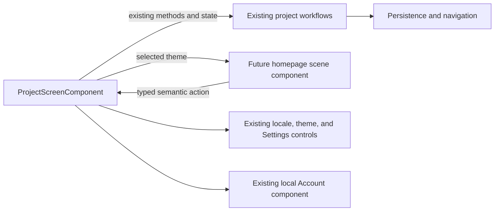

# Phase 1 — 3D Homepage Technical Design

**Status:** design proposal for Phase 2. The current Angular homepage remains
the traditional Project Screen. This phase imports source artwork and defines
contracts; it adds no scene, GLB, route, or UI behavior.

## Goal and boundaries

The future homepage is one stylized laundry room shared by Minecraft (`craft`),
Light, Raccoon, and Dark. The room uses the supplied PNG layers as visual and
material references, then adds real thickness, lighting, and perspective. The
Project Screen remains the owner of project data and every existing workflow.

Phase 1 does not change the Editor, persistence, Undo/Redo, project formats,
settings, themes, localization, or account behavior. Source PNGs are stored
under `Frontend/public/assets/homepage/source/` and are not referenced by the
application.

## Decisions and assumptions

| Kind                 | Contract                                                                                                                                                                                           |
| -------------------- | -------------------------------------------------------------------------------------------------------------------------------------------------------------------------------------------------- |
| Decision             | One shared room, semantic node IDs, attachment IDs, and camera policy serve all four themes. Theme changes replace materials, textures, and lighting only.                                         |
| Decision             | Three.js already installed in the frontend is the intended renderer. The homepage renderer has its own component/resource lifecycle and does not reuse the Editor viewport engine.                 |
| Decision             | Functional labels and actions remain Angular DOM. Project, Settings, theme, locale, and account state stay with current owners.                                                                    |
| Decision             | Load only the selected theme's artwork. Never rebuild a saved project just to create a decorative washer preview.                                                                                  |
| Assumption to verify | Initial room blockout is 16 units wide × 9 high × 12 deep. These are composition ratios derived from the 1672 × 941 artboard, not measured physical dimensions.                                    |
| Assumption to verify | A fixed 36° perspective camera at approximately `(0, 5.2, 15)` looking toward `(0, 3.5, -0.5)` frames the full room in normal desktop windows. Camera placement and FOV are Phase 2 tuning values. |
| Assumption to verify | Raccoons, foliage silhouettes, and exterior views can use bounded 2.5D cards because the first view is fixed. Any camera orbit would require a new asset-quality decision.                         |

## Verified source facts

- The archive contains 331 semantic layers: Minecraft 82, Light 82, Raccoon
  84, and Dark 83. There are 86 semantic IDs in the union, with 78 IDs present
  in all four themes. Theme-specific coordinates and omissions are retained.
- The canvas is 1672 × 941. The archive supplies 282 full-canvas masks. The
  manifest references 278 of them; four delivered masks are unreferenced by the
  manifest and are retained in the source tree and inventory.
- All 331 layer hashes and native dimensions were checked. All four source
  references match the existing files in `Docs/design/references/` byte for
  byte. An independent in-memory composition reproduced all four references
  with zero differing RGB pixels.
- `inferred-hidden-fill` is an inference from a flat image, not recovered
  original art. Baked edge matte may halo on a material different from its
  source background.
- Three source comparison PNGs are truncated. They remain byte-for-byte in
  provenance evidence and are not valid visual proof. The hidden temporary
  `reference/.02-light.png.ycYBQF` is truncated, is not used by the manifest,
  and is excluded from the source tree with that reason recorded.
- The package's standalone HTML/JS/Python demo was not copied into the public
  source tree or executed. Source-package QA claims are retained as supplied
  historical evidence, not as validation of this Angular application.

See [source provenance](source-assets/PROVENANCE.md) and
[source-package evidence](evidence/phase1-source-assets/README.md) for file
counts, exclusions, and validation limits.

## Project Screen ownership and future boundary

| Capability                                      | Existing owner                                                      | Phase 2 boundary                                                                                |
| ----------------------------------------------- | ------------------------------------------------------------------- | ----------------------------------------------------------------------------------------------- |
| Route, UI state, and action handlers            | `ProjectScreenComponent`                                            | Keep the route coordinator and its current workflow calls.                                      |
| Create, open, activate, delete, list loading    | `ProjectScreenWorkflow`                                             | Scene emits a semantic action; component calls the same workflow methods.                       |
| Structure JSON read, parse, validation, preview | `StructureJsonProjectImportWorkflow`                                | Keep validation and preview in the existing import flow.                                        |
| Project Backup import/export                    | `ProjectBackupWorkflow` and persistence services                    | Keep validation, export and non-overwriting restore behavior.                                   |
| Search and sorting                              | `filterAndSortProjectSummaries` in `project-screen-project-list.ts` | Supply the same summaries, query, and order to the board.                                       |
| Locale, themes, and Settings entry              | `ProjectScreenControlsComponent`, `I18nService`, `ThemeService`     | Keep controls outside the room at upper-right. Theme selection is passed as presentation input. |
| Settings draft/apply/cancel                     | Existing Settings dialog and Settings session                       | Keep the current draft lifecycle.                                                               |
| Account presentation                            | `ProjectScreenAccountComponent`                                     | Keep the local demo outside the room at bottom-left; do not imply authentication or cloud sync. |
| 3D viewport                                     | Editor-owned `ThreeViewportEngine`                                  | Keep homepage renderer resources separate from Editor state and lifecycle.                      |

The scene may emit a narrow event such as `openProject(projectId)` or
`deleteProject(projectId)`. `ProjectScreenComponent` continues to call its
existing handler. If a selected project is shown on the washer, selection is
transient presentation state and is not persisted. Do not add project store,
backup, import validation, or account state to the scene.

## Room and camera blockout

Use a right-handed Three.js world: +X points right, +Y up, +Z toward the
camera. Put the origin at the center of the floor `(0, 0, 0)`. The proposed
interior occupies `x = -8..8`, `y = 0..9`, and `z = -6..6`; the rear wall is
at `z = -6`, floor at `y = 0`, side walls at `x = ±8`, and ceiling at `y = 9`.
The camera-facing wall is an open cutaway. These values are a blockout only;
the CSV dimensions are projected image ratios and do not establish real depth.

| Semantic anchor                          | Proposed location and construction                                                                                |
| ---------------------------------------- | ----------------------------------------------------------------------------------------------------------------- |
| `room.door-opening`                      | Left side of rear wall. Model frame, jamb, sill, hinges, and door leaf; put layered exterior behind the aperture. |
| `room.window-opening`                    | Right side of rear wall. Model jamb, sill, mullions, and glass; put sky and city cards behind the opening.        |
| `room.shelf-wall`                        | Rear-left wall, clear of the door swing. Shelves and props attach to named shelf surfaces.                        |
| `room.washer-footprint`                  | Left-center floor. Washer front faces +Z; towels, crate, plant, and lantern attach to `washer.top.surface`.       |
| `room.project-board`                     | Right of center, face normal +Z. Preserve a clear board plane for readable Angular content.                       |
| `room.laundry-cluster`                   | Foreground near the washer. Basket, interior contents, bench, and stool rest on explicit surfaces.                |
| `room.mascot-left` / `room.mascot-right` | Front-side floor anchors. Initial raccoon cards pivot at the midpoint between feet.                               |

The fixed-camera opening composition is a composed room, not a flat full-screen
background. Model the floor depth, wall thickness, openings, and jambs. Exterior
layers sit behind the apertures so room frames can occlude them. Keep the door
and window style, floor, wall, and object layout stable across all themes.

### Camera and viewport

- Initial camera assumption: `PerspectiveCamera`, vertical FOV 36°, near 0.1,
  far 80, position `(0, 5.2, 15)`, target `(0, 3.5, -0.5)`. No orbit or free
  pan controls for the first design.
- The full room and fixed controls must fit at CSS viewports 1280 × 720 and
  1366 × 768 without F11, browser horizontal scrolling, or clipped controls.
- Use camera presets or a deliberate crop for portrait/narrow viewports; do not
  shrink the UI text below 14 CSS px or hide workflow actions.
- Recompute the DOM board plane from the current camera and viewport. Do not
  store theme-specific pixel coordinates as world-space placement.

## Asset, geometry, and attachment contracts

`3d-asset-plan.csv` contains one row per semantic ID, theme paths and coverage,
parent hints, source pixel bounds, provisional front ratios, proposed anchors,
representation, modeling work, and priority.

- `x/y/width/height` are image-space crop bounds. Provisional frontage maps
  1672 pixels to 16 world units and 941 pixels to 9 units. Depth remains
  unknown; all final bounds must come from the exported GLB node geometry.
- Model the room, floor, door/window frames, washer, board substrate, shelving,
  basket, furniture, and crates as complete stylized geometry. Use source crops
  and masks as color/detail references, not as a flattened scene background.
- Use fixed-camera 2.5D for layered exterior views and detailed raccoon
  silhouettes. Small plants may use a hybrid of modeled stems and layered leaf
  cards. Keep parallax subtle enough that source cutout edges do not separate.
- `inferred-hidden-fill` and `source-visible-edge` are modeling/compositing
  evidence only. Do not ship hidden-fill as recovered source truth. Validate
  every edge card against replacement theme materials and omit it if it halos.
- Account, logo, navigation, project cards, labels, and actions are Angular DOM
  or existing shared assets. Source UI artwork is a visual reference only.
  `washer-portal` contains sample artwork and must remain decorative; it is not
  a live thumbnail.
- Use semantic GLB node names matching CSV IDs. Anchors are named empties or
  node surfaces, each with a stable local origin and normal. Child transforms
  are relative to the supporting surface, not unrelated absolute coordinates.
- Suggested pivot: floor-contact center for freestanding props, mount center
  for wall-mounted objects, supporting-surface origin for attached props, and
  midpoint between feet for raccoon cards. DOM overlay surfaces have no mesh
  pivot.
- Replacing a parent model must preserve its semantic anchors and bounds
  contract or update all dependent children in the same model change. The
  `parent` column is source grouping metadata and must be verified against the
  physical model before it is treated as final.

## One room, four theme treatments

The same geometry node IDs, dimensions, anchors, camera, and UI layout serve
all four themes. Replace only theme material/texture sets and lighting.

| Theme               | Proposed material and lighting treatment                                                                                                    |
| ------------------- | ------------------------------------------------------------------------------------------------------------------------------------------- |
| Minecraft (`craft`) | Warm timber, stone and grass accents; bright daylight; warm lamps on.                                                                       |
| Light               | Pale plaster and clear timber; high-key daylight with enough contrast on the board and controls.                                            |
| Raccoon             | Cream and gray surfaces, soft rounded trim, and balanced daylight; same room geometry.                                                      |
| Dark                | Night exterior, cool moon/window fill, lower ambient contribution, room lamps off and bulbs non-emissive. Preserve readable board contrast. |

Load only the selected theme's texture set. Keep common GLB geometry shared;
release old theme texture references when switching after the replacement is
ready. Do not fetch or decode four complete theme sets on startup.

## Interaction, occlusion, and accessibility

- The project board is an Angular DOM surface using real `ProjectSummary`
  values, search/sort, create, and existing import/export entry points. Keep
  Open/Delete as real buttons with the existing confirmation/error paths.
- Map the washer opening to existing Open behavior only if an explicit project
  selection is active. Any Delete affordance calls the existing deletion path
  and confirmation. With no selection, selection-dependent actions are
  disabled.
- Keep controls/theme/locale/Settings in the upper-right and Account in the
  lower-left, outside the room's hit-test surface. At narrow sizes use a
  responsive DOM layout that remains reachable without F11.
- Preserve keyboard order, labels, focus rings, busy/disabled/error states,
  EN/VI strings, and reduced-motion behavior. No functional text is rasterized.
- Mark the WebGL canvas decorative for assistive technology. Use raycasting for
  hover/cursor feedback or non-text decorative affordances, not as the sole
  hit target for workflow buttons.
- Keep the board overlay unobstructed. Recompute its projected rectangle on
  resize and camera preset changes; do not let foreground meshes intercept
  board input.

## Pipeline and resource lifecycle

1. Keep imported source files immutable. Use masks for silhouette and UV
   reference; do not replace the flattened room with the whole reference PNG.
2. Model and author stylized materials in Blender. Export GLB/glTF with stable
   semantic node names, real thickness, attachment empties, and complete
   physical bounds.
3. Validate node IDs, parent links, pivots, bounds, material slots, and all
   anchor references before connecting the model to Angular.
4. The scene owner creates its own Three.js renderer after the route mounts,
   loads shared geometry and only the chosen theme textures, and emits typed
   presentation actions to the Project Screen.
5. On theme switch, replace theme resources and dispose the old textures after
   the new set is ready. On route teardown, cancel pending loads, stop the
   animation frame, disconnect observers, remove listeners, dispose geometry,
   materials, textures, render targets, and renderer.

Three.js `^0.186.0` is already installed. No new renderer or state-management
dependency is proposed. The existing Editor `ThreeViewportEngine` remains the
owner of editor camera, renderer, and GPU resources.

## Phase 2 minimum prototype

1. Build one room shell with floor, rear/side walls, ceiling, a left door
   opening, and a right window opening. Prove exterior layers are occluded by
   modeled frames.
2. Implement a detailed Minecraft material pass for the shell, washer, board,
   shelf, basket, and two fixed-camera raccoon cards. No default untextured
   cube blockout may be presented as the final prototype visual.
3. Put live Project Screen content on the board as Angular DOM and route every
   action through existing handlers. Verify Create/Open/Delete, search/sort,
   Structure JSON import, Project Backup import/export, Settings, Account,
   EN/VI, and all themes remain available.
4. Apply all four material/light sets to the same geometry. Instrument resource
   requests to confirm that unselected theme files are not fetched or decoded.
5. Exercise narrow camera/layout, keyboard/touch/focus, resize, theme-switch
   disposal, and route teardown.

## Measurable Phase 2 acceptance criteria

- At 1280 × 720 and 1366 × 768 normal browser viewports, the room is fully
  framed without F11, browser-level horizontal overflow, clipped controls, or
  overlap between scene and UI.
- At 390 × 844 and 320 × 700, all workflows remain reachable by keyboard and
  touch, controls do not overlap, no page-level horizontal scroll occurs, and
  interactive text is at least 14 CSS px.
- All four themes preserve identical semantic node IDs, camera target, and
  attachment IDs. A network/decode trace shows zero requests/decodes for
  unselected themes.
- The board reads current project summaries only. No baked sample project,
  account state, or reconstructed structure appears as live data. Every
  Open/Delete action reaches the current workflow and its existing
  confirmation/error path.
- Theme switch and route teardown leave no active frame loop, observer,
  listener, pending texture request, or undisposed theme texture. Verify with
  repeated mount/unmount and theme-switch browser runs.
- Proposed resource targets for the prototype: no more than 64 MiB of decoded
  selected-theme texture data, 150 draw calls, and 200k visible triangles at
  desktop size. Profile on a named hardware/browser setup; these are targets,
  not measured Phase 1 results.

## Risks and open verification

- A single front artwork view does not define side/back dimensions or hidden
  surfaces. Model those from the visual style and review them explicitly.
- Four source themes have different pixel positions and omissions. Normalize
  them to semantic node bounds instead of allowing theme changes to move props.
- Hidden fills are inferred; edge PNGs include source-background matte and may
  fail on a new material.
- The board is a dynamic UI plane in perspective. Its font size, focus ring,
  occlusion, and touch targets need browser verification on narrow screens.
- Putting 55,026,645 bytes of source PNGs under Angular `public/` means the
  production build copies them into its browser output even though the current
  app does not load them. Phase 2 should select files by request and review
  deployment/CDN caching before enabling runtime fetches.
- Source-package standalone browser claims were not independently rerun.
  Hardware GPU frame time, exact physical dimensions, mask quality on final
  materials, and browser accessibility remain Phase 2 verification work.
