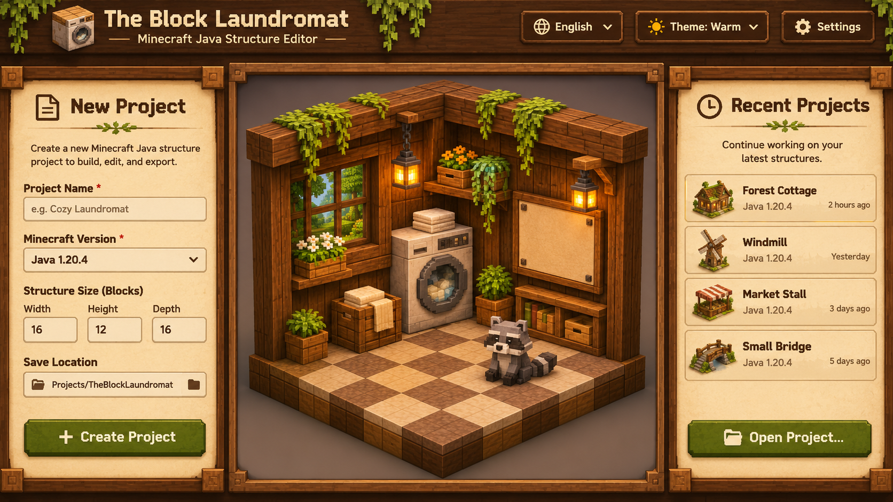
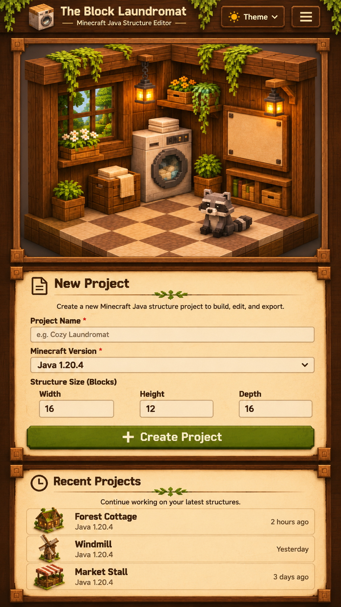
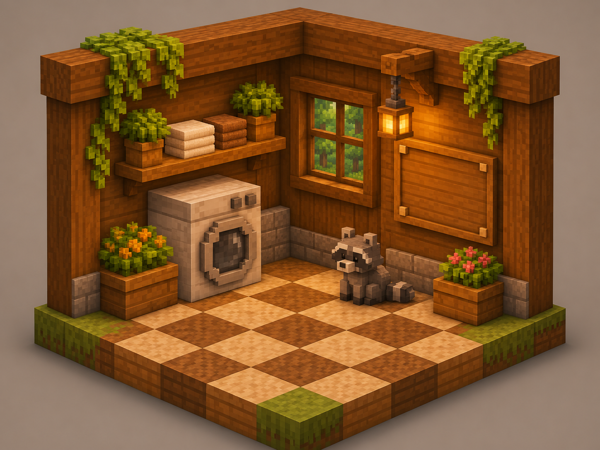

# Goal 02C look-dev package

**Concept art gate: PASS — the user approved the in-scene Raccoon direction, room composition A, and all four scene themes on 2026-11-17.**

This package proposes new homepage art direction and scene concepts. It is review material only: no production route, Project workflow, persistence, Editor, dependency, or Mini Diorama code has changed.

## Reference readback

The latest user-supplied room image sets the visual style: chunky Minecraft blocks, richly textured dark oak, gray stone, leaf-block vines, planter greenery, and warm amber lanterns. Keep that cozy cottagecore material language across the room and the surrounding Project Screen UI. Use timber and cream-paper panels with restrained moss-green actions; do not turn the UI into the pastel kawaii style of the Tooplate example.

The [Spatial Diorama ZIP](../../../design/references/2171_spatial_diorama.zip) informs only the scene geometry: a shallow platform, a 5 × 5 square checker floor, two perpendicular walls, and a small set of repeated primitives. The checker tiles here use cream and natural brown/stone colors to match the user's visual reference. Do not carry over the ZIP's lavender/mint palette or its top HUD, object hotspots, and bottom dock.

The room in the user's reference is much denser than the scene should be. Keep its style while simplifying construction to repeated box geometry and a few shared assets: timber beams, square window, short shelf, washer, blank board, lantern, a few plants, and a small Raccoon. The board stays blank so real project data can be rendered in Angular DOM.

The requested live URL returned HTTP 200 and the title “Kawaii Spatial Diorama 3D - Live View”. The browser access host was unavailable, so live interaction and responsive behavior could not be captured. Archive observations come from static inspection of `index.html`, `css/style.css`, `js/app.js`, and `js/diorama.js`; no artwork or implementation from the archive is copied into these concepts.

## Proposed Project Screen

Keep the user's confirmed new three-column layout: a persistent New Project panel on the left, the 3D room in the center, and Recent Projects on the right. The top bar contains language, theme, and settings controls. The room and outer panels share the same warm Minecraft timber style, but project fields, labels, accessibility, and actions remain semantic Angular DOM.

These generated screens are visual/layout concepts. Names, dates, Minecraft versions, field values, save location, thumbnails, and visible action labels in the mockups are sample artwork, not project data or a revised workflow contract. The production screen must preserve the existing Project Screen behavior, including the current create/import/open/export/delete flows. See [the Project Screen template](../../../../Frontend/src/app/features/projects/project-screen/project-screen.component.html) and [workflow](../../../../Frontend/src/app/features/projects/project-screen/project-screen-workflow.ts).

At narrow widths, keep the app bar and semantic controls in the DOM, reframe the room to a portrait camera, and stack the create form and project list below it. Do not move project names or controls into scene textures. The mobile concept demonstrates the portrait camera and vertical flow; it is not a production breakpoint specification.

## Room composition options

### A — Checker stage (user-approved)

The washer and blank board sit across the back corner, with the checker floor open in front. The user selected this composition. Keep the ivy to a few repeated leaf clusters; represent the plant as a pot plus shared leaf cubes.

### B — Board left, washer right

The board gets a broad left-wall surface for the Angular overlay, while the washer remains a clear hero prop on the right. The window stays near the corner to preserve the forest view without crowding the board.

### C — Window left, washer center, board right

The window and centered washer make the shop feel lived in; the right-side board remains separate. Keep the Raccoon small enough to sit on the platform without obscuring the washer or floor.

All three concepts use the same core scene kit: one platform, 25 tiles sharing geometry/materials, two walls, a few timber beams, one window, one shelf, towels, one washer, one blank board, a lantern, a few plants, a simple basket, and the Raccoon. Avoid the reference image's fireplace, dining furniture, deep shelf maze, and many unique small props. None of those are needed to retain its visual style.

| Composition       | Focal hierarchy                                                                        | Framing trade-off                                                                                             |
| ----------------- | -------------------------------------------------------------------------------------- | ------------------------------------------------------------------------------------------------------------- |
| A — Checker stage | Washer and blank board share the back wall; open checker floor anchors the foreground. | Most balanced on desktop; portrait framing can keep both heroes visible above the Raccoon. **User-approved.** |
| B — Board left    | Wide blank board is the main left-wall surface; washer balances it on the right.       | Best space for Angular DOM on desktop; a narrow portrait view may need to prioritize the board or washer.     |
| C — Window left   | Window adds depth, washer centers the room, board stays distinct on the right.         | Strongest environmental storytelling; three focal points are the busiest option on mobile.                    |

## Raccoon options

The user preferred the small seated Raccoon in the [four-theme room image](concepts/themes-four-way-buildable.png) over the earlier character sheets. The three updated turnarounds now use that low, compact Minecraft voxel style, with gray fur, a strong charcoal eye mask, short muzzle, and floor-resting striped tail. The user-selected in-scene Raccoon remains the art-direction source; the turnarounds expand it into front, three-quarter, side, and greeting/seated views for review.

| Option                                                 | Appeal, expression, and silhouette                                                                       | Minecraft identity and room fit                                                                                                 | Rig/build trade-off                                                                                                    |
| ------------------------------------------------------ | -------------------------------------------------------------------------------------------------------- | ------------------------------------------------------------------------------------------------------------------------------- | ---------------------------------------------------------------------------------------------------------------------- |
| [Puddlepaw](concepts/raccoon-puddlepaw-turnaround.png) | Low seated quadruped; broad mask, compact cheeks, and a calm curious look. **User-preferred direction.** | Gray block fur and floor-resting ring tail match the selected scene Raccoon; fits beside the washer without covering the board. | Best match to the selected idle pose; simple head/body and four-limb hierarchy with a segmented tail. **Recommended.** |
| [Tumble](concepts/raccoon-tumble-turnaround.png)       | Low walking body, alert gaze, and raised arched tail make the silhouette more active.                    | The tail gives the clearest classic raccoon outline and reads well against the tile floor.                                      | More limb and tail movement than the seated direction; needs a walk cycle to deliver its appeal.                       |
| [Pebble](concepts/raccoon-pebble-turnaround.png)       | Broad, loaf-like sit with tucked paws and a looped tail; soft, relaxed expression.                       | Smallest floor footprint and strongest cozy idle pose for the cottage room.                                                     | Easiest idle rig; a convincing walk is less natural with the wrapped tail and tucked legs.                             |

These are original design explorations, not reproductions of the supplied Raccoon reference, the Sketchfab `ooa_raccoon`, or Alex’s Mobs model/texture. Use the same voxel surface language as the room when authoring a production model.

## Four scene themes

The room geometry and props stay consistent. These retained references have notably different color treatments; preserve those differences instead of applying one palette to every theme:

| Theme     | Reference                                             | Time          | Color direction                                                                                                     |
| --------- | ----------------------------------------------------- | ------------- | ------------------------------------------------------------------------------------------------------------------- |
| Light     | [02-light.png](../../references/02-light.png)         | Early morning | Bright, airy cream and pale oak, fresh green foliage, and a clear blue-green view. **User-approved.**               |
| Minecraft | [01-minecraft.png](../../references/01-minecraft.png) | Sunset        | Strong orange-gold window light, richer honey oak, and vivid Minecraft greens. **User-approved.**                   |
| Raccoon   | [03-raccoon.png](../../references/03-raccoon.png)     | Around 6–7 PM | Muted taupe and gray-brown timber, violet-blue dusk view, and distinct amber lamps. **User-approved.**              |
| Dark      | [04-dark.png](../../references/04-dark.png)           | Late night    | Deep navy-blue shadows and exterior, cyan moonlight at the windows, and restrained amber lights. **User-approved.** |

The comparison board keeps one geometry while pushing those four color identities farther apart. The matching [palette source](four-theme-palette.svg) is an editable scene-art proposal, not a change to existing application CSS tokens. Minecraft continues to use the existing internal theme key `craft`.

## Buildability notes

Build the room from a small reusable set. Use shared box geometry for tiles, beams, shelves, towel stacks, and frame parts; use a small shared leaf cluster rather than modeling each vine segment uniquely. The board is a plain surface with a stable DOM placement anchor. Text and project content are never baked into a texture.

The washer and Raccoon are hero assets. The washer shell can stay procedural if its drum reads clearly; author the bezel in Blockbench only if the stepped pixel ring needs more control. Author the Raccoon in Blockbench. Keep walls, floor, window, shelf, towels, plant, lantern, and simple basket procedural or as reusable grouped props. The [asset pipeline](asset-pipeline.md) describes source ownership and export/import contracts.

## Review gate

**PASS — concept art accepted by the user on 2026-11-17.** The accepted direction is the compact seated Raccoon shown in the theme board, composition A (Checker stage), and the four distinct time-of-day themes above. This approval closes the Goal 02C art gate only. It does not authorize production scene implementation or approve the Project Screen mockup as a production UI; those remain outside Goal 02C.

## Goal 02D checkpoint

Historical Goal 02D created an original editable Puddlepaw Raccoon candidate and integrated its standalone GLB into `/mini-diorama-preview`. Goal 02E superseded that route asset with the supplied assembled laundromat GLB, which includes its own Raccoon. At the user's request, the unused Puddlepaw model, atlas, standalone GLB, and per-asset README were removed. Production adoption and formal art approval remain open; the earlier statements above describe Goal 02C scope and remain historical.

The browser verification passed route loading, the four existing theme controls, EN/VI, keyboard and pointer input, reduced motion, WebGL fallback, the root Project Screen, and 20 route mount/unmount cycles. Its 120 headless SwiftShader frame intervals measured 33.3 ms median and 33.4 ms p95; this is diagnostic software-rendering data, not representative physical-GPU performance. Review captures are kept in the ignored `Frontend/.artifacts/goal-02d/raccoon-review/` directory.
