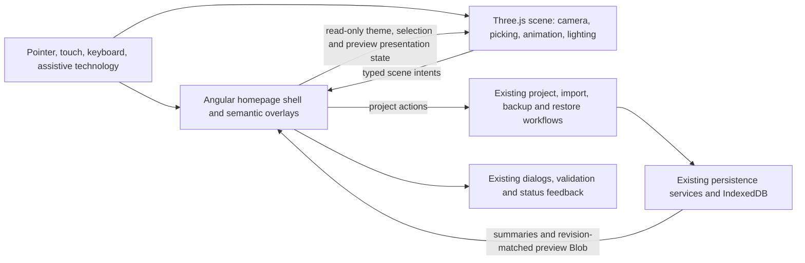

# Stage 1 — Spatial Homepage Product Direction

**Status:** User-approved on 2026-11-19 (“Duyệt bản nháp”). This approves the Stage 1 product direction; it does not start implementation or asset production.  
**Scope:** Source audit and product/interaction specification only. No application code, models, or assets were changed or created.  
**Repository baseline:** `main`, HEAD `439a98e59e045014f1518dfa7ebcf2d57401c822` (2026-11-19).  
**Reference archive:** `Docs/design/references/2171_spatial_diorama.zip`, SHA-256 `cbc5ebf7aa1d4c61e5a4801a52262ec5eb35fd4bed34140b44874334ae02bb4e`; ZIP integrity check passed.

## Audit findings and evidence

### What the reference source actually implements

The archive was inspected directly and its JavaScript was not executed. The source separates the page UI in `2171_spatial_diorama/js/app.js` from the Three.js scene in `2171_spatial_diorama/js/diorama.js`; `index.html` and `css/style.css` keep the stage, hotspots, dock, and panels as separate DOM elements. This is evidence about mechanisms in source, not a claim that the archived page was run in a browser.

| Area | Verified in archive source | Pattern to learn / limitation to avoid |
| --- | --- | --- |
| Scene and camera | `diorama.js` creates one full-window Three.js renderer, uses `OrbitControls`, disables pan, bounds orbit angles, and clamps wheel zoom. Camera focus poses and perspective framing adjust when the viewport changes, including portrait layout. | A full spatial canvas, bounded orbit/zoom, and responsive focus poses can work together. Keep the project room, but do not adopt the source's global coupling or copy its renderer implementation. |
| Picking and contextual UI | A raycaster handles scene hits; DOM hotspots and dock buttons open the same HTML panels. Hotspots are positioned from 3D anchors. Short taps/clicks are distinguished from drags; a floor click can request character movement. | Give each scene action an equivalent semantic DOM control and route both through one typed intent. Preserve a clear distinction between camera drag and object activation. |
| Character | One stylized Bunny has idle, walk, jump, proximity, and collision-aware movement states. Object focus can move the character toward a room spot. | Character motion can react to user intent, but the reference has one Bunny, not the required pair of Raccoons. Do not copy its character, model, movement code, or narrative. |
| Ambient and lighting | Source animates plants/clouds/sparkles, a canvas-textured TV, a gently varying light, and hover feedback. Renderer setup includes capped pixel ratio and an adaptive quality downgrade. | Use sparse, low-amplitude room motion and theme-aware lighting. Ambient motion must never compete with project names, actions, or camera control. |
| DOM, keyboard, and forms | Panels are HTML with live status regions and `inert` toggling. `app.js` manages focus on open/close, Escape, keyboard shortcuts, gallery keys/drag, and form validation/focus. CSS defines visible focus and a reduced-motion media rule. | Reuse the separation of scene presentation from accessible DOM behavior. The Angular application should use typed component contracts instead of the reference's global `window.GM635` bus. |
| Responsive and fallback | CSS changes panels to bottom sheets and the dock for narrow screens; camera code has portrait-specific framing. A WebGL probe/boot error switches the page to a no-3D state while the DOM UI remains. | Reframe the room for portrait; do not shrink a desktop crop. Keep all project workflows available in fallback. The source does not demonstrate full context restoration. |
| Resource lifecycle | Source has a continuing animation-frame loop and a context-lost listener, but no complete scene teardown path that cancels animation, removes all listeners, disposes controls, and releases every scene resource. | Keep the current application's explicit route-scoped runtime cleanup. The archive is not a lifecycle template. |

Source locations checked: `index.html` (21, 23, 46–58 and panel markup); `app.js` (13, 203–264, gallery input around 335–369, form validation around 440–481); `diorama.js` (renderer setup around 51–60, `OrbitControls` and clamped wheel zoom at 566–580, responsive camera poses from 560 onward, raycast picking from 649, resize/performance handling around 940–980, and render/context events at 1124–1130); `css/style.css` (focus at 59, responsive and reduced-motion rules at 493–546). The archived page's palette, images, copy, Bunny, and implementation are reference-only and must not be reused.

### Current homepage compared with that source

The current `/homepage-integration-preview` route wraps `ProjectScreenComponent` with the integration-preview flag. It retains the existing New Project form and Recent Projects list around a scene card. Its interaction controller raycasts the washer, board, and Raccoon targets and emits typed presentation intents; the semantic equivalents are overview/washer/board/Raccoon focus buttons. A drag is not treated as an object activation, but there is no free orbit/zoom camera interaction. The board is decorative: selecting it focuses the existing project search/list rather than selecting a project in the scene. Washer focus currently moves focus to the project-name field. The Raccoon greeting intent has no connected project action. Thus the current scene is a framed preview with scene shortcuts, not the spatial project workflow described here.

The data path is already suitable for preserving workflow ownership. `ProjectScreenWorkflow`, the existing import and backup workflows, `ProjectPersistenceService`, and IndexedDB remain authoritative. `ProjectSummary` does not contain a thumbnail. A separate revision-keyed preview store already provides `openPreview(projectId, expectedUpdatedAt)`; the Editor captures and stores a preview when leaving the Editor. The homepage does not currently read those previews. A future scene may receive the currently selected project's matching cached Blob as read-only presentation input; it must not read IndexedDB or generate a fake image. If no current preview exists, show the project's actual text details and an explicit “Preview not yet available” state.

### Current dependencies, consumers, and documentation

- `Frontend/package.json` already includes Angular `~22.2.2` and Three.js `^0.186.0` (with matching `@types/three`). No new rendering dependency is needed for a future spatial homepage.
- `Frontend/src/app/app.routes.ts` maps `/` to `ProjectScreenComponent`; `/editor` stays behind `editorCanDeactivate`; `/homepage-2d-preview`, `/mini-diorama-preview`, and `/homepage-integration-preview` are separate lazy preview routes. This Stage 1 leaves those route contracts unchanged.
- `MiniDioramaScenePanelComponent` is consumed by the standalone mini-diorama preview and the integration presentation. It owns translated status and semantic focus buttons; `MiniDioramaSceneRuntime` owns the renderer, model load, resize/visibility/reduced-motion/context-loss handling, camera rig, raycast controller, animation loop and explicit disposal. Its current camera is a fixed overview/target focus rig, not free orbit/zoom.
- `ProjectScreenComponent` remains the workflow-facing consumer for the integration preview. It calls the current project workflow, backup/import workflows, and theme/localization services; `EditorShellComponent` and the viewport capture the Editor preview. The separate `/homepage-2d-preview` uses a Canvas 2D renderer and is not a second project persistence owner.
- Read `Docs/design/homepage/README.md`, `ADR-001-rendering-engine.md`, `stage-2-spatial-concepts/README.md`, and `Frontend/source-assets/homepage-redesign/README.md`. Those documents confirm the current preview-vs-production boundary, the existing Three.js choice, and the selected room-first direction. The superseded Goal 02C look-dev package was removed at the user's direction.

### Browser evidence for the current implementation

These are actual local browser captures taken through Chrome DevTools MCP in an isolated browser context. The test data store was empty; no project data was changed. The approved concept images are static visual references and do not prove interaction behavior. The archived reference was not run, so no reference-runtime screenshot interaction is claimed.

| Current browser capture | Finding |
| --- | --- |
| [1440×900 — Minecraft](../../../Frontend/.artifacts/spatial-homepage-stage-1/current/1440x900-minecraft-en.png) | Three-column form / scene-card / project-list layout; room occupies a small part of a large card. |
| [1440×900 — Light](../../../Frontend/.artifacts/spatial-homepage-stage-1/current/1440x900-light-en.png), [Raccoon](../../../Frontend/.artifacts/spatial-homepage-stage-1/current/1440x900-raccoon-en.png), [Dark](../../../Frontend/.artifacts/spatial-homepage-stage-1/current/1440x900-dark-en.png) | Theme identity is present, but Light reads washed/neutral, Raccoon shifts purple, and Dark loses scene detail compared with the approved warm daylight / warm-gray twilight / lantern-lit references. |
| [1024×768 — Minecraft](../../../Frontend/.artifacts/spatial-homepage-stage-1/current/1024x768-minecraft-en.png) | Three columns remain; New Project becomes narrow and its controls wrap. |
| [390×844 — Minecraft, viewport](../../../Frontend/.artifacts/spatial-homepage-stage-1/current/390x844-minecraft-en-viewport-current.png) | In a fresh isolated browser, the canvas grew from 287 CSS px at ~0.5s to 1,015 px at ~8s. The viewport shows mostly blank canvas and only a wall edge; Chrome had logged 96 `ResizeObserver loop completed with undelivered notifications` errors by the final sample. |
| [320×568 — Minecraft, viewport](../../../Frontend/.artifacts/spatial-homepage-stage-1/current/320x568-minecraft-en-viewport-current.png) | In a fresh isolated browser, the canvas grew from 350 CSS px at ~0.5s to 1,878 px at ~8s. The room leaves the visible frame; Chrome had logged 206 repeated ResizeObserver errors by the final sample. |
| [320×568 — Vietnamese project form](../../../Frontend/.artifacts/spatial-homepage-stage-1/current/320x568-minecraft-vi-form-current.png) | Vietnamese labels wrap (including the size label) but fit the 320px viewport without horizontal overflow. Reaching the form required scrolling past the expanding canvas. |

The measurements above use viewport-only screenshots from fresh isolated browser contexts. Repeated time samples show the mobile height expansion without using full-page capture; full-page capture can make the expansion worse, so those images are excluded as responsive evidence. The existing CSS has an auto-height mobile scene card with nested `height: 100%` scene hosts, and the runtime resizes from a `ResizeObserver`; this is consistent with a sizing feedback cycle, but the exact cause still needs a focused implementation-stage trace. At 320, 390, and 1024 CSS pixels, measured `scrollWidth` matched the viewport; no horizontal overflow was observed. There are baseline captures only; Stage 1 has no after screenshots.

Current composition reference: [approved octagonal room](stage-2-spatial-concepts/approved-octagonal-room.png). It establishes the room silhouette and compact Raccoon scale; detailed material and 3D alignment decisions are deferred to the next scene review.

## A. Product Vision

Make the laundromat room the homepage itself: a readable, cozy Minecraft-inspired voxel space that users can look around and act within. The project board is the real project index; the washing machine is the selected project's real preview and action point; two Raccoons make the space feel inhabited and respond to the same user actions.

Use compact, contextual UI in and around the room. Keep project names, forms, dialogs, search, status, and actions as real Angular DOM so they remain readable, keyboard-operable, localizable, and accessible. Spatial presentation should clarify the workflow rather than replace or duplicate it. Keep the four theme identities and EN/VI support. The reference contributes interaction principles only; its pastel art direction and assets are not the target.

## B. Interaction Architecture

| Responsibility | Owner and contract |
| --- | --- |
| Project list, search/sort, selected project ID, loading/error/confirmation state, focus order and DOM overlays | Angular homepage shell. It passes only display state to the scene. The selected ID is ephemeral UI state, not a second project store. Existing `ThemeService` and `I18nService` remain the owners of theme and locale preferences. |
| Project create/open/delete/import/export/backup/restore, confirmation, editor navigation and project mutations | Existing workflows and dialogs. Actions from a note, washer, menu, keyboard or fallback call the same workflow entry point and preserve current behavior. |
| Project summaries and revision-matched preview Blobs | Existing persistence services and IndexedDB. A preview is used only when its revision matches `updatedAt`; missing/stale previews remain explicit missing states. |
| Renderer, camera, raycast mapping, scene-only selection feedback, character/ambient animation, theme lighting, resize and GPU lifecycle | Route-scoped Three.js runtime. It receives presentation inputs and emits narrow typed intents; it does not own project data, dialogs, persistence, localization, or workflow decisions. |
| Accessible controls and equivalents | Angular DOM. Scene hotspots/object hits dispatch the same intent as their DOM control. Dynamic note text is never baked into a texture. Dialogs stay DOM-owned and restore focus to their invoking control. |

The reference proves a separate scene/UI boundary, DOM hotspots, focus-aware panels, and camera/object interactions. This design keeps those useful boundaries while replacing its global event bus with Angular input/output contracts and keeping project state in the current workflow/persistence boundary.

## C. Object Responsibility Map

| Object | Responsibility and interaction | Data / accessibility contract |
| --- | --- | --- |
| Project note board | Shows the actual project list as vertically scrollable paper notes. Selecting a note gives it a clear selected state and updates the washer. A “New Project” note/button opens a create dialog using the current fields and the existing create workflow. | Note labels and controls are Angular DOM, not texture text. The list has a named scroll region and keyboard-accessible items. Search and sort remain available in the board overlay. Empty/loading/error states are stated in the same region. |
| Washing machine | Shows the selected project's actual cached preview inside the drum when present; illuminates and highlights when selected. Contextual Open and Delete actions appear at the washer. | Preview is the existing Editor-captured Blob only when revision-matched. Otherwise show real project name/version/size and “Preview not yet available”; never substitute a sample. Open uses the current open workflow. Delete uses the current confirmation and delete workflow. No selection means no project actions. |
| Raccoon A — note courier (proposed role) | Has quiet idle motion. On New Project, carries a paper note to a clearly actionable create affordance. Clicking it opens the existing create dialog. | The note is a semantic DOM button with the same action as the accessible New Project control; animation is decorative and never required to start creation. |
| Raccoon B — washer guide (proposed role) | Shares idle behaviors. When a project is selected, both Raccoons react and approach the washer; this Raccoon leads or gestures toward the washer. | Motion is a presentation response only. It does not change selection, save data, move the camera unexpectedly, or block controls. |
| Lantern and plants | Lantern has subtle theme-aware flicker; leaves sway gently. Other small ambient cues may respond to selection without changing workflow state. | No rapid flash or essential status communicated only by color/motion. Reduced motion freezes or greatly simplifies ambient motion while retaining every action. |
| Room and camera | Frame board, washer, and both Raccoons as one coherent room. Selecting an item may gently reframe while keeping the board/washer relationship visible. | Camera state never owns project state. Provide pointer/touch and keyboard routes for orbit/zoom/recenter; do not require drag precision to reach actions. |

The existing assembled GLB contains one Raccoon instance. A second character and the required paired choreography are future approved-art/implementation work; no geometry, GLB, or animation is changed in Stage 1. The supplied pack has no recorded license/provenance file, so production redistribution rights remain unresolved.

## D. User Journey & State Matrix

| Journey / trigger | Visual and state transition | Data/workflow effect | Accessible equivalent and edge states |
| --- | --- | --- | --- |
| 1. Homepage opens | Room loads at an overview framing; board, washer, and two characters are visible. Board presents loading, populated, or empty state. | Load via existing project workflow. No sample projects. | DOM status announces load/failure. Empty list offers New Project and import actions. |
| 2. Observe, orbit, zoom | Drag/touch or explicit controls move a bounded camera; recenter returns to overview. | None. | Keyboard orbit/zoom/recenter controls expose names and focus. Scene fallback keeps DOM usable. |
| 3. Browse and scroll notes | Vertical board list scrolls independently. Search/sort updates visible real notes. | Existing summaries only. | Named scroll region; every note reachable and announced. At mobile widths, list remains usable without clipping the room's primary controls. |
| 4. Select a project | Note selection is explicit; washer lighting/selection updates and both Raccoons approach it. Matching cached preview loads by project ID and `updatedAt`. | Read current summary and existing revision-keyed preview only. | Keyboard note activation does the same. Missing/stale preview shows project facts and “Preview not yet available”; read errors have a retry/status path. |
| 5. Open project | Washer Open action shows busy feedback, then routes through current project open behavior to the Editor. | Existing `ProjectScreenWorkflow.openProject`; Editor leave guard, autosave, undo/redo remain unchanged. | Button has a project-specific accessible name; keyboard activation and focus/error handling match the existing workflow. |
| 6. Delete project | Washer Delete opens the existing confirmation. Cancel closes and restores focus; confirm removes the selected note and clears washer selection. | Existing `deleteProject` and persistence. | Dialog labels the project and both outcomes; errors leave data and selection consistent. |
| 7. Request a new project | Courier presents a note; note activation opens a create dialog using the current project form fields. | No mutation until valid submission; submit calls the existing create workflow and keeps its current navigation semantics. | The same create action is always available as a DOM control, including with motion reduced or WebGL unavailable. |
| 8. Create project | Dialog validates the current name, dimensions, version, and project options; feedback is explicit. | Existing project create flow and IndexedDB only. | Invalid fields expose text errors and focus; success/error is announced. No new scene-owned form state. |
| 9. Import, export, backup, restore | Compact Utilities control opens the current actions without crowding the board/washer. Existing dialogs/progress are preserved. | Existing Structure JSON import, per-project export, backup/package restore workflows. | All actions remain named DOM controls and reachable without scene picking; validation and confirmation remain unchanged. |
| 10. Loading, empty, failure, reduced motion, WebGL unavailable | Scene and board show explicit status; no-3D mode leaves a useful DOM project workspace. Reduced motion removes travel/ambient movement but keeps state changes and controls. | Existing data paths continue; no fake preview or duplicate storage. | `aria-live` status where appropriate, focusable fallback controls, visible error/retry, and no action whose only cue is animation, color, or sound. |

## E. Spatial UI Principles

- **Camera and stage:** Full-viewport room, not a large bordered scene card. Desktop starts with board, washer, and both Raccoons readable. Orbit is bounded and has a clear recenter action. Zoom has limits. Selection may make a gentle focus adjustment, but must not cause surprise rotation or hide either end of the board-to-washer flow.
- **Touch and responsive framing:** Recompose the camera for portrait and narrow viewports; do not scale a desktop crop until the room or controls disappear. Keep the project list's vertical scrolling separate from scene orbit gestures. Provide visible touch controls and preserve page/overlay scrolling. At 320×568, essential project operations must remain reachable without an unbounded canvas height.
- **Contextual overlays:** Anchor concise DOM overlays near the board and washer when space permits. Give them collision/safe-area rules and a predictable compact layout when anchors are off-screen. Forms, utilities, confirmation, errors, and dynamic text stay in Angular DOM. Pair every mesh action with a DOM control.
- **Focus and input:** Pointer drag orbits; a short tap/click activates a target; touch and keyboard can perform the same actions. Provide keyboard focus for scene controls and object actions. Preserve visible focus and return focus after dialogs. Do not let canvas listeners swallow form input, text selection, Escape handling, or assistive technology controls.
- **Theme and readability:** Preserve the approved room/material language while tuning presentation per theme: Minecraft craft uses warm crafted wood and amber; Light uses bright natural wood/daylight; Raccoon uses warm gray twilight; Dark uses blue night with lantern light that keeps washer, notes, and character silhouettes legible. Keep text contrast independent of scene lighting. Do not import the reference's blush/mint/lavender palette.
- **Motion and performance:** Character movement and ambient motion are slow, interruptible, and never block input. Reduced motion removes or shortens movement and camera easing while preserving selection, preview, create, open, and delete behavior. Keep quality reduction graceful on constrained devices.
- **Fallback and lifecycle:** When WebGL is unavailable or context is lost, announce the state and retain all project controls in DOM. On route teardown cancel animation frames, remove listeners, stop character/audio work, dispose controls and owned GPU resources, and prevent duplicate render loops after remount.

## F. Design Decisions

| Keep | Replace or redesign | Do not carry forward |
| --- | --- | --- |
| Existing Project Screen workflows, project summaries, IndexedDB, revision-keyed preview service, existing dialogs, Editor navigation/guard, undo/redo/autosave, four themes, and EN/VI. Keep `/` unchanged until a later explicit production-adoption decision. | Three-column form/card/list presentation becomes a room-first composition with board and washer as the core workflow anchors. Four camera presets become bounded orbit/zoom, responsive overview, and selected-object focus. Decorative board becomes a real selectable project list; washer becomes the real preview/action point; the current create form is presented in a contextual dialog and still submits through the same workflow. One scene Raccoon becomes a pair with the stated roles. | Reference source code, global event bus, pastel palette, Bunny, gallery/content/assets, sample/fake projects or previews, alternate persistence, or business rules inside the scene. Do not make the existing fallback or fixed focus buttons the only accessible route. |

### Clean-code constraints for a later approved implementation

- **Architecture and ownership:** keep scene rendering, Angular presentation/state, workflow mutations, and persistence as separate owners.
- **Legacy and dead code:** inventory route and component consumers before removing the form-based presentation or fixed focus controls; retire replaced paths only after workflow and accessibility parity is verified. Do not change `/` or Editor routes in this stage.
- **Folder structure and file naming:** place future code by homepage, scene-runtime, workflow, or persistence responsibility; keep names searchable and aligned with the owning concept.
- **Generalization and semantic contracts:** use narrow typed scene inputs/intents; avoid a new global bus, duplicated project store, broad context bag, or second renderer.
- **Documentation and references:** update the current design/source-of-truth docs and record asset provenance when a new character source is selected.
- **Formatting and code style:** follow the repository's Angular/TypeScript conventions and configured Prettier formatting; do not reformat unrelated files.

No implementation, asset work, production migration, or automated checks were run for this design-only Stage 1. The mobile canvas height issue and source/rig for a second character are implementation checkpoints for a later approved stage. The current supplied pack's provenance also remains unresolved.

## G. Decisions approved by user

The user approved this draft as written on 2026-11-19.

1. **Raccoon pair identity:** The pair uses the proposed courier/washer-guide role split, shared idle behaviors, and role differences expressed first through staging/pose. Distinct authored appearances would need a separate art direction and approved source before implementation.
2. **Projects without a cached preview:** Show actual project details and “Preview not yet available” until the Editor has stored a revision-matched image. Do not use a fake preview or add a second renderer/persistence path.

No unresolved product decisions remain for this Stage 1 specification.

## Gate status

| Gate | Status | Evidence |
| --- | --- | --- |
| A — Product vision | PASS | Section A reflects the room-first direction and fixed requirements. |
| B — Object responsibility and interaction architecture | PASS | Sections B–C are compared against the inspected ZIP source and name concrete improvements over the current homepage. |
| C — Workflow and state transitions | PASS | Section D routes mutations through existing workflow/persistence owners and covers all ten journeys/states. |
| D — Accessibility, responsive behavior, and data integrity | PASS (design) | Section E defines DOM parity, responsive reframe, reduced motion, fallback, and preview revision rules. The current preview implementation still fails the mobile canvas-sizing check recorded above; this is a known implementation issue for a later stage. |
| E — User review and approval | PASS | The user approved the draft as written on 2026-11-19, including the two decisions in Section G. |

**Overall: PASS — Stage 1 specification approved.** No implementation, asset production, or production-route change has started; a later stage still requires an explicit user request.
