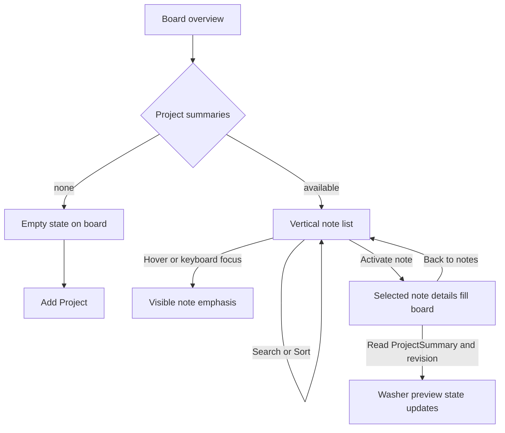
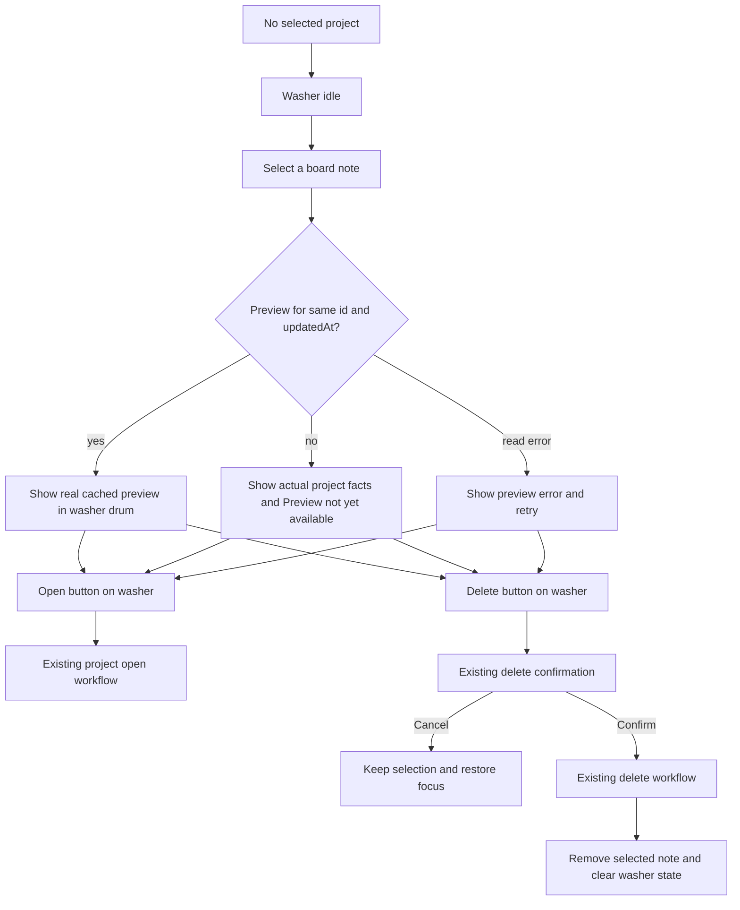
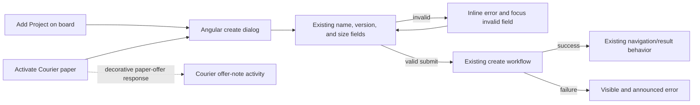
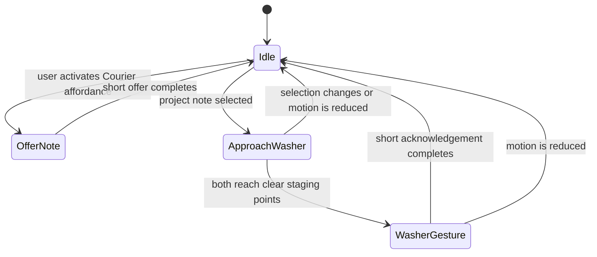
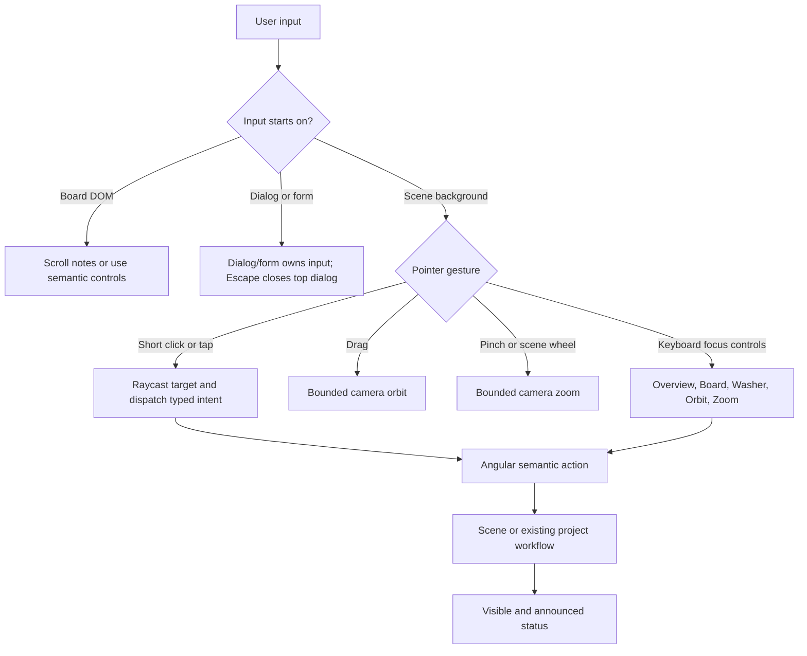

# Stage 2 — Spatial interaction architecture

**Status:** Design specification for Stage 3 review. No Angular or Three.js
behavior is changed by this document.

## Ownership and evidence

The approved octagonal room defines physical composition. Angular owns project
data, translated text, accessible controls, dialogs, and workflow calls. The
scene runtime owns camera, picking, character presentation, lighting, and
resource lifecycle. A scene hit emits a typed intent to Angular; it never reads
or mutates persistence directly.

The archived Spatial Diorama source was inspected directly in
`Docs/design/references/2171_spatial_diorama.zip`. Its separate scene and DOM
owners, bounded camera, ray picking, equivalent HTML hotspots, and explicit
dialog focus behavior are source-verified patterns. Its Bunny, code, copy,
assets, and visual styling are not reused. Its page was not executed; no runtime
behavior is inferred from its screenshots.

The current homepage was inspected in Chrome DevTools at
`/homepage-integration-preview` (1440×900, isolated empty project store). It
still shows the New Project form and Recent Projects in separate columns around
a tall scene card, whose existing square two-wall diorama sits low in a large
empty canvas. This confirms the composition gap; it does not prove future
scene behavior. Current route, workflow, and runtime boundaries were checked
in `app.routes.ts`, `ProjectScreenComponent`, `MiniDioramaScenePanelComponent`,
`MiniDioramaSceneRuntime`, and `ProjectPersistenceService`.

### Current browser evidence (2026-11-19)

Captured screenshots and DOM measurements are in the ignored local folder
`Frontend/.artifacts/spatial-homepage-stage-2/current/`; these are audit
artifacts, not source assets.

- At **1440×900**, all four existing theme selectors render. In every theme,
  the existing room is small inside a much larger rounded scene card; the
  project board is decorative and empty. Minecraft is dark/warm, Light is
  pale-neutral, Raccoon is purple, and Dark is blue-black. The Raccoon theme
  already has a distinct purple canvas, while the user-approved references call
  for muted warm gray-brown surroundings and dusky plum light. The concept
  palette comparison therefore restores this distinct identity without
  changing room geometry.
- At **1024×768**, the three columns remain and the new-project form becomes
  narrow: size labels wrap and import actions wrap across lines. Page width did
  not exceed the viewport in this capture.
- In a **fresh isolated 390×844** Chrome mobile context, after seven seconds the
  document measured 390×2362 px and the scene canvas measured 356×975 px. The
  screenshot showed a large blank canvas with only the top wall edge entering
  the viewport; the washer, board, fireplace, and Raccoon were below it.
- In a **fresh isolated 320×568** context, after seven seconds the document
  measured 320×3536 px and the scene canvas 286×2126 px. The first viewport was
  blank canvas below the header. Neither sample had horizontal page overflow;
  vertical canvas growth and scene clipping remain an implementation defect.

These captures verify the current layout only. They do not verify the proposed
camera mockups, a screen-reader experience, or future Stage 3 behavior.

## Interaction diagrams

### Project board: browse, scroll, select

- Notes are semantic DOM buttons with title and concise metadata. Selected,
  hover, keyboard-focus, loading, empty, and error states remain visible without
  relying on color alone.
- Search, Sort, and Add Project sit in the board's DOM header. Note content
  scrolls vertically inside the board viewport. Wheel, touch, and pointer
  events that start inside this DOM region do not orbit or zoom the camera.
- Activating a note replaces the board list with its full project details on
  the board. `ProjectSummary.id` and `metadata.updatedAt` identify the current
  selection; no project name or metadata is baked into a Three.js texture.

### Washer: revision preview and contextual actions

- Open and Delete are separate, labelled DOM buttons visually anchored beside
  the washer controls. They are not part of the paper note. A note selection
  creates a visible link to the washer (selected state and drum illumination).
- Only the current revision-keyed preview from the existing preview store may
  be shown. If it is absent, stale, or unreadable, show project facts and an
  explicit status; do not synthesize a project image.
- Delete keeps the existing confirmation and error behavior. Cancel preserves
  data and selection; success clears selection and announces completion.

### New Project note and Courier

- The paper is a visible affordance; its icon and any short prompt are DOM
  content. Activating the paper and the Add Project control have the same
  accessible effect. Courier motion is decorative and never required to create
  a project.
- No data is created until the existing form validates and submits. The
  existing workflow remains the only owner of creation and navigation.

### Two Raccoons: presentation state

- Note Courier idles near the board; Washer Guide idles near the washer. Their
  identity should read from compact silhouette/face/tail differences plus
  pose and role prop, while retaining the approved natural, low-built
  proportions. Do not make one unusually tall or heavy.
- Waypoints stay on the open floor, outside the board face, washer action
  targets, fireplace opening, and one another's collision envelope. Selection
  may send both along short non-crossing paths toward two washer-adjacent
  staging points; it does not change project state or move the camera without
  an explicit camera action.
- Idle breathing, grooming, scratching, greeting, and note-offer timing are
  presentation details. Reduced motion leaves both in stable poses and keeps
  all DOM controls active.

### Camera, picking, and input routing

- Desktop overview, focus-board, focus-washer, and recenter are compact
  semantic buttons near the viewport edge; they are not a large detached
  toolbar. A corresponding DOM control exists for each important scene hit.
- Scene orbit is bounded, zoom is clamped, and camera focus uses smooth
  transitions. Mobile has a portrait camera preset and safe-area controls; it
  frames the full room instead of cropping the desktop composition.
- A press/move threshold separates picking from drag. The note-list surface
  owns its scroll. Inputs, buttons, and dialogs own their keyboard and pointer
  events. Escape closes the topmost dialog before any scene shortcut runs.
- Reduced motion shortens or removes camera easing and disables ambient
  movement. It does not hide state, disable actions, or remove keyboard routes.
- WebGL unavailable or context lost switches to a useful DOM workspace with
  the same project workflows and a clear scene status. Scene cleanup cancels
  the animation frame and pending load, removes observers/listeners, disposes
  controls, and releases owned GPU resources.

## Current versus proposed contracts

| Responsibility         | Current implementation evidence                                                                                                              | Stage 3 contract                                                                                                                                                                            |
| ---------------------- | -------------------------------------------------------------------------------------------------------------------------------------------- | ------------------------------------------------------------------------------------------------------------------------------------------------------------------------------------------- |
| Page composition       | `ProjectScreenComponent` owns a three-column form/scene/list arrangement on desktop; `/homepage-integration-preview` wraps it.               | Room is the dominant viewport surface. Create/import utilities remain accessible as compact DOM controls/dialogs; the production root route is unchanged until a separate adoption request. |
| Board                  | Existing assembled scene has a decorative board. A scene hit focuses the existing project list; no project is selected through a board note. | Board DOM owns real vertical notes and their selected detail view, with independent scroll.                                                                                                 |
| Washer                 | Existing scene hit focuses the project-name field. No project preview/actions are washer-anchored.                                           | Current selected project drives a revision-keyed preview and washer-local Open/Delete controls.                                                                                             |
| Camera                 | `MiniDioramaCameraRig` switches between fixed overview/focus bounds and adapts aspect/FOV. No orbit/zoom controls are implemented.           | Bounded orbit/zoom, responsive overview, focus board/washer, recenter, and non-surprising selection behavior.                                                                               |
| Character              | `Laundromat.glb` contains one Raccoon; controller adds a short greet and idle head/tail motion.                                              | Two individually identifiable Raccoons with safe routes and role activities; no workflow ownership.                                                                                         |
| Accessibility/fallback | Semantic scene action buttons, live status, reduced-motion handling, WebGL fallback, and runtime disposal already exist.                     | Preserve these and cover the new board/washer/dialog interactions with keyboard/focus/status equivalents and regression tests in Stage 3.                                                   |

## Stage 3 acceptance checkpoints

1. Keyboard and pointer can browse and select a note, use washer actions, and
   complete create/open/delete without accessing the 3D scene.
2. Scroll over notes never moves the camera. Camera drag is never reported as
   a project activation. Touch uses the same separation.
3. Board and washer remain visible together on desktop; portrait framing
   includes the room and primary touch controls at 390×844 and 320×568.
4. Open/Delete, creation, persistence, import/backup, Editor navigation, and
   confirmation remain owned by current workflows.
5. Reduced motion and WebGL fallback retain all useful actions.
6. Runtime lifecycle has no duplicate persistence owner, leaked listeners,
   unbounded frame loop, or GPU resources after route teardown.
