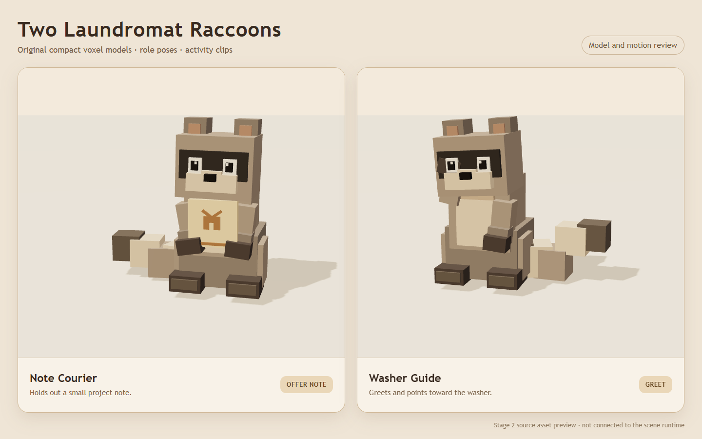

# Spatial homepage Raccoons

These two original, low-voxel Raccoon models are authored by
[`generate.mjs`](../../../../tools/homepage-raccoon-assets/generate.mjs)
and exported as self-contained GLB files beside this document.

| Asset        | Character distinction                                                                | Output                     |
| ------------ | ------------------------------------------------------------------------------------ | -------------------------- |
| Note Courier | Holds a small paper note; tail rests in a low sweep; includes the `offer-note` clip. | `raccoon-note-courier.glb` |
| Washer Guide | Raises one forepaw; tail has a modest upward curl; includes the `greet` clip.        | `raccoon-washer-guide.glb` |

Both use compact seated proportions, gray-brown cuboid fur, a dark face mask,
cream muzzle, and banded tail. Their current difference comes mainly from
pose, tail silhouette, and one small prop rather than exaggerated body size.
The Chrome preview makes clear that their head/body shapes are still similar;
distinct face/ear/cheek silhouettes remain pending user's visual review before
any Stage 3 model refinement.

## Model contract

- Local forward is `+Z`; ground contact is `y = 0`.
- Each file has one `Raccoon` root at the established `0.86` scene scale.
- `ForelegL`, `ForelegR`, `Head_BroadCheekMask`, and `Tail_Banded` are stable
  named pivots for existing presentation controls.
- Geometry and PBR materials are generated from the shared unit cuboid in the
  source script. No external model, texture, or added dependency is used.
- The `offer-note` and `greet` clips use named pivots; the host runtime owns
  when they play and when their animation mixer is stopped.

Regenerate from `Frontend/` with:

```sh
node tools/homepage-raccoon-assets/generate.mjs
```

The models are source assets only. The current mini-diorama preview still loads
the existing `models/laundromat/Laundromat.glb`; these two GLBs are not copied
to runtime or integrated into the laundromat scene by this task.

## Preview

The preview below is a Chrome render of both exported GLBs with the
`offer-note` and `greet` clips playing. It shows an activity pose from each
clip; the complete motion is stored as the named animation tracks in the GLBs.


